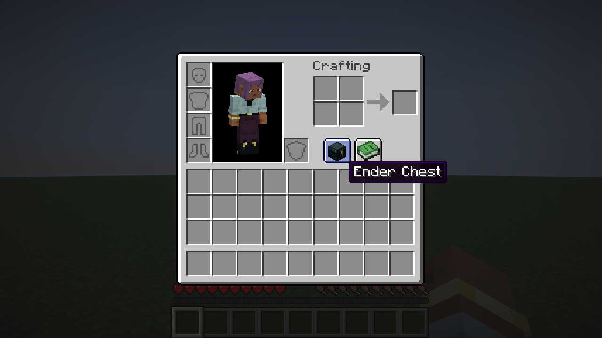

# Ender Link

Open your ender chest from a button beside the inventory's recipe book. No ender chest item is needed.



Requires the [Ender Link server plugin](https://github.com/PluginsKers/enderlink). The server owns the inventory and controls access. Without the plugin, the button stays disabled. Players without this mod can use `/enderlink`.

The button matches the vanilla recipe book. It is disabled while carrying an item and hidden when the recipe book covers the inventory in narrow windows.

## Installation

Supports Minecraft 1.21.11, 26.1, 26.1.1, 26.1.2, 26.2, and 26.3. Requires Fabric Loader 0.19.5 or newer and Fabric API.
Download the jar matching your Minecraft version from [Releases](https://github.com/PluginsKers/ender-link-client/releases) and place it in your client's `mods` folder. Use Java 21 for 1.21.11 and Java 25 for 26.x.

## Building

```sh
./gradlew build compileGametestJava
./gradlew :26.3:runClientGameTest
```

Use `gradlew.bat` on Windows. Run Gradle with JDK 25; the Java 21 toolchain is downloaded when needed. Game tests require a display. `build` builds all versions; `:1.21.11:build` builds one. Jars are written to `versions/<minecraft>/build/libs`.
GitHub Actions checks each supported version. Version tags publish the jars to GitHub Releases.

## License

[MIT](LICENSE).

The logo and banner use Minecraft artwork by Mojang Studios.
